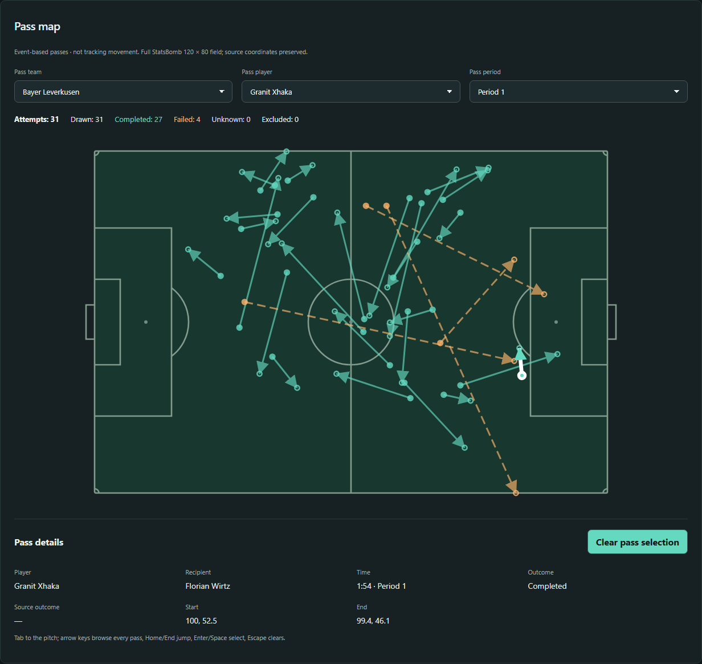

# Football Data Platform

Платформа для разбора футбольных матчей: интерактивные карты событий, сравнение
команд и статистика игроков на основе воспроизводимого конвейера данных.

[English](README.md) · [Русский](README.ru.md) · [Документация](docs/README.md)

## Лаборатория матча



Карта из работающего dev-интерфейса: Гранит Джака, первый тайм матча Bayer
Leverkusen–RB Leipzig сезона 2023/24. Всего 31 передача: 27 успешных и 4
неуспешных. Это не макет и не публичный демосервис.

Источник данных — **StatsBomb Open Data**. Официальный логотип для атрибуции:


## Что можно сделать

- **Изучить передачи:** полное поле StatsBomb 120×80, стрелки направления,
  фильтры команды, игрока и периода, исходы и доступная панель деталей.
- **Разобрать удары:** карта ударов связана с графиком накопленного xG и деталями
  выбранного события. Серия пенальти показана отдельно от обычной статистики.
- **Сравнить команды в матче:** официальный результат, показатели хозяев и гостей.
- **Посмотреть вклад игроков:** матчевые метрики, фильтр активности и полная
  заявка, включая игроков без событий.
- **Найти нужный матч:** выбор соревнования и сезона, поиск, прямые ссылки,
  обновление страницы и навигация назад/вперёд.
- **Выбрать язык:** EN/RU/ES, управление клавиатурой и адаптивная вёрстка.

Это аналитика внутри матча, а не отдельные профили команд и игроков.
Карта передач построена по событиям, не по трекингу перемещений; координаты
StatsBomb не следует считать физическими метрами.

## Проверенное покрытие данных

| Набор | Контекст | Матчи | Передачи | Покрытие |
| --- | --- | ---: | ---: | --- |
| Чемпионат мира 2022 | `43/106` | 64 | 68515 | Все матчи турнира |
| Бундеслига 2023/24 | `9/281` | 34 | 39214 | Только матчи Bayer Leverkusen: **34/306** игр лиги |
| Всего | Два контекста | 98 | 107729 | Загруженные исторические срезы |

По этой выборке Бундеслиги нельзя строить рейтинги всей лиги. Сезон
**2026/27 ещё не интегрирован**. Таблица описывает проверенный срез платформы,
а не весь текущий каталог поставщика. Подробнее — в [описании источников](docs/data-sources.md).

## Как устроена платформа

```text
StatsBomb JSON → Selectel S3 Bronze → Spark Silver/Gold → ClickHouse → Django API → React
```

Bronze сохраняет исходные байты. Silver нормализует события, составы и матчи,
Gold формирует матчевые аналитические наборы. Неизменяемые артефакты,
детерминированные build IDs, manifests и каталог PostgreSQL связывают
исходные файлы с данными ClickHouse.
Airflow управляет явно запущенными конвейерами, Superset отвечает за BI,
Grafana — за представление качества данных. Веб-запросы читают ClickHouse,
не S3 и не PostgreSQL. Детали — в [архитектуре](docs/architecture.md).

## Технологии

| Область | Текущая реализация |
| --- | --- |
| Приложение | React 19, TypeScript, Vite; Django 5.2 / Gunicorn |
| Аналитика | ClickHouse 25.8; Spark 4.2.0 / Hadoop 3.5.0; Parquet |
| Озеро и каталог | Selectel S3; PostgreSQL 17 |
| Оркестрация и наблюдаемость | Airflow 3.2.2; Superset 6; Grafana 13 |
| Локальный запуск | Docker Compose; Nginx; операторские инструкции Windows/PowerShell |
| Проверки | unittest, Vitest, Playwright/Chromium, Ruff, GitHub Actions |

Версии закреплены в репозитории. Различия Python runtime описаны в
[руководстве разработчика](docs/development.md); установленный на хосте Python
не заменяет закреплённые окружения.

## Безопасное начало

Нужны Git и Docker с Compose v2. Для нового checkout:

```powershell
git clone https://github.com/Romanweiss/football-data-platform.git
cd football-data-platform
docker compose --env-file .env.example config -q
```

Команда проверяет публичный шаблон конфигурации: сервисы не запускаются,
секреты не создаются, данные не загружаются. В checkout есть код и синтетические
fixtures, но нет настоящего S3-озера и наполненных баз. Перед запуском приложения
пройдите [инструкцию разработчика](docs/development.md), а не старые команды ingestion.

Адрес уже настроенного dev-интерфейса — `http://127.0.0.1:15173`.
Опциональный production-like origin — `http://127.0.0.1:18090`, только локально.
**Pass Map принят на локальном production-like 18090 (Stage 9B.1-D).**
См. [результаты deployment acceptance](docs/stage9b1-deployment.md). Pressure Heatmap
(Stage 9B.2-A) — локальная разработка, не опубликована и не развёрнута на 18090.

## Навигация по документации

- [Общий индекс](docs/README.md) — руководства, runbooks и история этапов.
- [Архитектура](docs/architecture.md) — слои данных, serving и границы доступа.
- [Разработка](docs/development.md) — подготовка, API и offline-тесты.
- [Источники](docs/data-sources.md) — покрытие, смысл событий и условия использования.
- [Эксплуатация](docs/operations.md) — сервисы, DQ, секреты и ограничения recovery.
- [Pass Map: контракт и evidence](docs/stage9b1.md).
- [Исторический архив](docs/archive/README.md) — прежний README целиком и карта переноса.

## Статус и ограничения

Опубликованный baseline продукта — [`fd6212d`](https://github.com/Romanweiss/football-data-platform/commit/fd6212d5972150e11ca0161efe0e5fa32cce4992).
[CI fast](https://github.com/Romanweiss/football-data-platform/actions/runs/40764227972)
и [CI integration](https://github.com/Romanweiss/football-data-platform/actions/runs/40764227888) для него прошли успешно.

- Это локальная production-like платформа, **не публичный hosted service**.
  Публичная авторизация, TLS ingress, HA и гарантии нагрузки пока не подтверждены.
- Ответ карты передач ограничен 5000 отображаемых строк и 4 MiB. Превышение
  возвращает явную ошибку; скрытого усечения нет. При наложениях помогает клавиатура.
- Сохранена семантика источника: нет собственной модели xG, per90, трекинга
  или интегрированного потока текущего сезона.
- Мониторинг не принимает изменения источника автоматически и не запускает ingestion.
- Изолированное локальное S3-восстановление **VERIFIED**, но весь **Stage 8C — PARTIAL**.
  Offsite, remote S3 и полное восстановление после потери машины не проверены.
  См. [recovery evidence и оставшиеся проверки](docs/stage8c-r2-4a2-4c.md).

## Источник и права использования

Футбольные данные и исходный xG предоставляет [StatsBomb Open Data](https://github.com/hudl/open-data).
Действует [Public Data User Agreement](https://github.com/hudl/open-data/blob/master/LICENSE.pdf)
с отдельными требованиями к атрибуции. Нельзя считать данные свободными для
любого распространения или коммерческого использования. Перед публикацией
анализа прочитайте [раздел об условиях](docs/data-sources.md#attribution-and-licensing).
Отдельного software-файла `LICENSE` в репозитории пока нет; MIT/CC-лицензия
и одобрение проекта поставщиком не подразумеваются.
